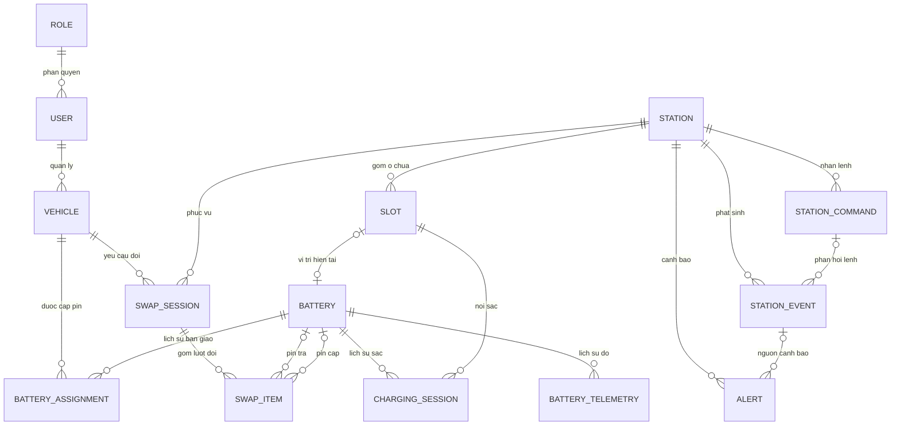

# E-BatterySwap

**E-BatterySwap** là đồ án xây dựng **hệ thống quản lý và mô phỏng trạm đổi pin thông minh cho xe máy điện**. Hệ thống gồm ứng dụng khách hàng, ứng dụng web quản lý/giám sát và IoT Simulator mô phỏng hoạt động của trạm mà không cần chế tạo phần cứng thật.

> **Trạng thái:** Đang phân tích và thiết kế. Phạm vi hiện hành tập trung vào vận hành trạm đổi pin thông minh, **không triển khai thuê bao, tính phí hoặc thanh toán**. SRS v0.1 đã được duyệt trước khi điều chỉnh phạm vi này và cần được rà soát/cập nhật tương ứng. Các chức năng mô tả dưới đây là yêu cầu dự kiến, chưa phải tính năng đã hoàn thành.

## 1. Mục tiêu và phạm vi

- Xây dựng quy trình đổi pin tự động: khách hàng dùng Mobile App quét QR trạm, yêu cầu đổi **1 hoặc 2 viên pin** và theo dõi kết quả.
- Quản lý người dùng, phương tiện, quyền sử dụng pin, từng viên pin, trạm và ô chứa.
- Mô phỏng tiếp nhận pin cũ, kiểm tra hợp lệ, cấp pin mới, điều khiển cửa ô tủ và xử lý các tình huống bất thường.
- Theo dõi thông số **SOC** (State of Charge – mức sạc), **SOH** (State of Health – sức khỏe pin), nhiệt độ; lưu lịch sử đo để phục vụ giám sát.
- Mô phỏng quá trình sạc tự động và ghi nhận các phiên sạc, bao gồm hoàn thành, gián đoạn hoặc lỗi.
- Giám sát lệnh điều khiển, sự kiện phản hồi, cảnh báo và giao dịch đổi pin không hoàn tất hoặc hoàn thành một phần.

**Ngoài phạm vi hiện tại:** quản lý gói thuê pin (ServicePlan), thuê bao (Subscription), khoản phí (Charge), thanh toán (Payment), bán xe và chế tạo phần cứng trạm thật. Việc bỏ thuê bao không đồng nghĩa bỏ kiểm tra quyền sử dụng pin.

## 2. Thành phần hệ thống

| Thành phần | Trách nhiệm |
| --- | --- |
| **Mobile App** | Khách hàng đăng nhập, quản lý thông tin và xe, tìm trạm, quét QR, yêu cầu đổi pin, theo dõi tiến trình và xem lịch sử. |
| **Web Application (Customer Portal + Admin Dashboard)** | Một ứng dụng web chung; Customer Portal phục vụ tra cứu tài khoản/xe/lịch sử, Admin Dashboard dành cho nhân viên và quản trị viên vận hành, giám sát và xử lý sự cố. Phân quyền theo vai trò. |
| **Backend API** | Xác thực, phân quyền, kiểm tra quyền đổi pin, điều phối giao dịch, quản lý trạng thái và giao tiếp với Simulator. |
| **Database (Microsoft SQL Server)** | Lưu dữ liệu người dùng, xe, quyền sử dụng pin, pin, trạm, ô tủ, giao dịch, thông số đo, phiên sạc, lệnh, sự kiện và cảnh báo. |
| **IoT Simulator** | Mô phỏng ô chứa, khóa/cửa, nhận diện pin, cảm biến, quá trình sạc, phản hồi lệnh và các lỗi vận hành. |

Mobile App và Web Application dùng chung Backend API, không truy cập trực tiếp cơ sở dữ liệu.

## 3. Chức năng dự kiến

### 3.1. Khách hàng

- Đăng ký, đăng nhập và quản lý tài khoản, phương tiện.
- Xem danh sách trạm và trạng thái phục vụ.
- Quét mã QR bằng Mobile App để xác định trạm; Backend tiếp tục xác thực quyền đổi pin.
- Yêu cầu đổi **1 hoặc 2 viên pin**, theo dõi tiến trình và xem lịch sử giao dịch.

### 3.2. Nhân viên và quản trị viên

- Ghi nhận bàn giao pin lần đầu cho xe/khách hàng qua Admin Dashboard; không triển khai quy trình bán xe.
- Quản lý người dùng, phương tiện, pin, trạm và ô chứa.
- Theo dõi trạng thái hiện tại và lịch sử **SOC, SOH, nhiệt độ** của pin.
- Theo dõi quá trình sạc, tình trạng kết nối trạm, lệnh điều khiển và phản hồi của Simulator.
- Giám sát các phiên đổi pin, cảnh báo và hỗ trợ xử lý giao dịch bất thường.

### 3.3. IoT Simulator

- Mô phỏng mở/đóng cửa, nhận diện pin được đưa vào hoặc lấy ra và phản hồi lệnh điều khiển.
- Mô phỏng kiểm tra pin cũ, cấp pin mới khi đủ điều kiện và cập nhật trạng thái thực tế.
- Mô phỏng tự động sạc pin; ghi nhận lịch sử thông số đo và phiên sạc.
- Mô phỏng lỗi pin không hợp lệ, lỗi cửa, mất kết nối, gián đoạn sạc và giao dịch đổi pin hoàn thành một phần.

## 4. Quy tắc nghiệp vụ cốt lõi

- **Pin thuộc sở hữu đơn vị vận hành**; hệ thống ghi nhận quyền sử dụng pin đã bàn giao cho khách hàng/xe.
- Pin ban đầu được nhân viên ghi nhận bàn giao qua Admin Dashboard.
- Sử dụng **một chuẩn pin chung** cho các dòng xe được hỗ trợ; mỗi xe dùng 1 hoặc 2 viên.
- Cho phép đổi pin ở **mọi mức SOC hợp lệ**, miễn thỏa điều kiện về quyền sử dụng pin, trạng thái trạm và an toàn.
- **QR chỉ dùng để xác định trạm**, không tự động mở khóa. Backend phải kiểm tra quyền đổi pin trước khi điều khiển trạm.
- Hệ thống chỉ coi hành động vật lý là đã thực hiện khi nhận được sự kiện/phản hồi phù hợp từ Simulator; gửi lệnh không đồng nghĩa với thành công.
- Một phiên đổi hai viên có thể **hoàn thành một phần**; phải ghi nhận kết quả của từng viên, không tự động coi toàn phiên thành công.
- Cần phân biệt **quyền sử dụng pin** với **vị trí vật lý hiện tại** của pin.

> **Chi tiết chưa chốt:** thứ tự đổi 2 viên; ngưỡng SOC/SOH/nhiệt độ khi cấp pin mới; timeout cửa; kiểm tra pin trả; cách ly pin lỗi; cơ chế mất kết nối và khôi phục giao dịch. Các giá trị minh họa trong Simulator sẽ không mặc nhiên được coi là quy tắc nghiệp vụ chính thức.

## 5. Định hướng thiết kế CSDL (Bước 1 – đã chốt)

Danh sách **14 thực thể** đã được chốt ở Bước 1. Các mối quan hệ ở sơ đồ tổng quan bên dưới đang được đề xuất tại Bước 2; chưa chốt thuộc tính, khóa hoặc cấu trúc bảng SQL cụ thể.

| Nhóm nghiệp vụ | Thực thể | Trách nhiệm chính |
| --- | --- | --- |
| Người dùng và phương tiện | **User** | Tài khoản người dùng |
| | **Role** | Vai trò và phân quyền |
| | **Vehicle** | Phương tiện sử dụng dịch vụ đổi pin |
| Pin và trạm | **Battery** | Viên pin và tình trạng hiện tại |
| | **Station** | Trạm đổi pin |
| | **Slot** | Ô chứa của trạm |
| | **BatteryAssignment** | Lịch sử cấp/thu hồi quyền sử dụng pin |
| | **BatteryTelemetry** | Lịch sử đo SOC, SOH, nhiệt độ |
| | **ChargingSession** | Lịch sử từng phiên sạc |
| Giao dịch đổi pin | **SwapSession** | Phiên đổi pin |
| | **SwapItem** | Kết quả đổi từng viên pin trong phiên |
| Mô phỏng và giám sát | **StationCommand** | Lệnh Backend gửi Simulator |
| | **StationEvent** | Sự kiện/phản hồi từ Simulator |
| | **Alert** | Cảnh báo và trạng thái xử lý |

### ERD tổng quan – Bước 2 (bản đề xuất, chưa duyệt)

Sơ đồ dưới đây thể hiện đủ **14 thực thể** và các mối quan hệ chính bằng ký hiệu Crow's Foot. Mức 1–N mô tả **lịch sử nhiều bản ghi**, không mặc định rằng mọi thực thể đều bắt buộc có dữ liệu liên quan ngay khi được tạo.

**Lưu ý khi đọc sơ đồ:**

- `VEHICLE` và `BATTERY` có quan hệ **N–N theo lịch sử**, được thể hiện qua `BATTERY_ASSIGNMENT`. Quan hệ hiện tại còn cần ràng buộc riêng.
- `SWAP_ITEM` có hai vai trò pin khác nhau: **pin trả** và **pin cấp**. Khi giao dịch đang xử lý hoặc gặp lỗi, một trong hai vai trò có thể chưa được xác định.
- Quy tắc **mỗi phiên đổi 1 hoặc 2 viên** là ràng buộc nghiệp vụ; ký hiệu Crow's Foot 1–N chưa thể hiện giới hạn trên là 2.
- Các quan hệ **SLOT–BATTERY (vị trí hiện tại)**, **STATION_COMMAND–STATION_EVENT (phản hồi lệnh)**, **STATION_EVENT–ALERT (nguồn cảnh báo)** là **đề xuất cần kiểm tra**. Không mặc định mọi sự kiện đều phát sinh từ một lệnh hoặc mọi sự kiện đều tạo cảnh báo.
- Vị trí vật lý của pin, quyền sử dụng khi giao dịch gián đoạn và cách cập nhật dữ liệu từ Simulator sẽ được làm rõ trước khi duyệt ERD logic chi tiết.

**Chưa đưa vào phạm vi:** ServicePlan, Subscription, Charge, Payment. **Chưa cần tách thành thực thể riêng:** BatteryMovement, MaintenanceRecord, AuditLog. Các đối tượng này có thể được xem xét lại nếu có yêu cầu mới.

**Tiến độ ERD:** Bước 1 (xác định thực thể) **đã chốt**; Bước 2 (quan hệ), Bước 3 (thuộc tính/ràng buộc) và ERD hoàn chỉnh **chưa chốt**.

## 6. Công nghệ sử dụng

| Hạng mục | Công nghệ / định hướng | Trạng thái |
| --- | --- | --- |
| Ngôn ngữ Backend | **C#** | Đã chọn |
| Backend Framework | **ASP.NET Core Web API** | Đã chọn |
| Giao tiếp ứng dụng | **REST API** dùng chung Mobile/Web | Định hướng |
| Mobile App | Chưa chọn framework | Chưa chốt |
| Web Application | **Một ứng dụng gộp Customer Portal + Admin Dashboard**; framework chưa chọn | Đã chốt mô hình |
| Database | **Microsoft SQL Server** | Đã chọn |
| IoT Simulator | Chưa chọn công nghệ cụ thể | Chưa chốt |
| Giao tiếp thời gian thực | Chưa chốt giao thức/công nghệ | Chưa chốt |

## 7. Trạng thái phát triển và tài liệu

- **Phân tích yêu cầu:** Có SRS v0.1 được duyệt trước khi thay đổi phạm vi; **cần cập nhật SRS** để bỏ nghiệp vụ thuê bao/thanh toán và phản ánh phạm vi trạm thông minh.
- **Thiết kế CSDL:** Đã chốt danh sách 14 thực thể (Bước 1). Chưa xác định quan hệ, thuộc tính, ràng buộc và chưa triển khai bảng.
- **Phân tích và thiết kế hệ thống:** Tiếp tục rà soát Use Case, Activity/Sequence Diagram theo phạm vi mới; chưa coi các sơ đồ là đã hoàn tất.
- **Phát triển và kiểm thử:** Chưa tuyên bố hoàn thành chức năng; sẽ cập nhật cấu trúc nguồn, hướng dẫn chạy, API documentation, demo và kiểm thử khi triển khai.

> README mô tả **phạm vi thiết kế hiện hành**, không thay thế SRS. Khi có thay đổi nghiệp vụ, cần đồng bộ tài liệu yêu cầu và kế hoạch trước khi triển khai.
