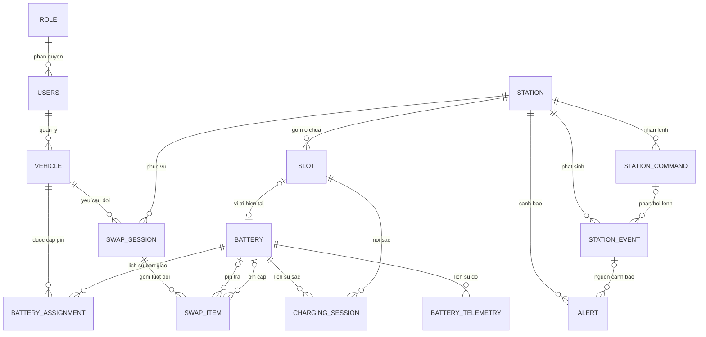

# ERD tổng quan – E-BatterySwap

> Sơ đồ khái quát cấu trúc dữ liệu của E-BatterySwap, bao gồm các thực thể nghiệp vụ và liên kết giữa chúng.

## Các thực thể và quan hệ tổng quan

Hệ thống gồm **14 thực thể**, được phân chia theo các nhóm nghiệp vụ. Sơ đồ tổng quan thể hiện quan hệ giữa các thực thể; đặc tả thuộc tính và ràng buộc nằm trong [tài liệu thiết kế CSDL](erd-design.md).

| Nhóm nghiệp vụ | Thực thể | Trách nhiệm chính |
| --- | --- | --- |
| Người dùng và phương tiện | **Users** | Tài khoản người dùng |
| | **Role** | Vai trò và phân quyền |
| | **Vehicle** | Phương tiện sử dụng dịch vụ đổi pin |
| Pin và trạm | **Battery** | Viên pin và tình trạng hiện tại |
| | **Station** | Trạm đổi pin |
| | **Slot** | Ô chứa của trạm |
| | **BatteryAssignment** | Lịch sử cấp/thu hồi quyền sử dụng pin |
| | **BatteryTelemetry** | Lịch sử đo SOC, SOH, nhiệt độ |
| | **ChargingSession** | Lịch sử từng phiên sạc |
| Giao dịch đổi pin | **SwapSession** | Phiên đổi pin |
| | **SwapItem** | Kết quả đổi từng viên pin trong phiên |
| Mô phỏng và giám sát | **StationCommand** | Lệnh Backend gửi Simulator |
| | **StationEvent** | Sự kiện/phản hồi từ Simulator |
| | **Alert** | Cảnh báo và trạng thái xử lý |

## Sơ đồ quan hệ thực thể

Sơ đồ dưới đây thể hiện đủ **14 thực thể** và các mối quan hệ chính bằng ký hiệu Crow's Foot. Mức 1–N mô tả **lịch sử nhiều bản ghi**, không mặc định rằng mọi thực thể đều bắt buộc có dữ liệu liên quan ngay khi được tạo.

**Lưu ý khi đọc sơ đồ:**

- `BATTERY_ASSIGNMENT` ghi nhận lịch sử liên kết giữa `VEHICLE` và `BATTERY`; các ràng buộc đồng thời về quyền sử dụng thuộc đặc tả nghiệp vụ.
- `SWAP_ITEM` có hai vai trò pin khác nhau: **pin trả** và **pin cấp**. Khi giao dịch đang xử lý hoặc gặp lỗi, một trong hai vai trò có thể chưa được xác định.
- Quy tắc **mỗi phiên đổi 1 hoặc 2 viên** là ràng buộc nghiệp vụ; ký hiệu Crow's Foot 1–N chưa thể hiện giới hạn trên là 2.
- `SLOT–BATTERY` mô tả vị trí hiện tại của pin; `STATION_COMMAND–STATION_EVENT` liên kết lệnh và phản hồi khi có; `STATION_EVENT–ALERT` liên kết sự kiện với cảnh báo khi có.
- Quyền sử dụng pin và vị trí vật lý là hai khía cạnh độc lập. Quy trình xử lý giao dịch gián đoạn được mô tả trong đặc tả nghiệp vụ tương ứng.

**Phạm vi mô hình:** Các thực thể trên phục vụ vận hành và giám sát trạm đổi pin; các nghiệp vụ thuê bao, tính phí và thanh toán không nằm trong phạm vi CSDL.

Xem [thiết kế bảng và thuộc tính](erd-design.md).
